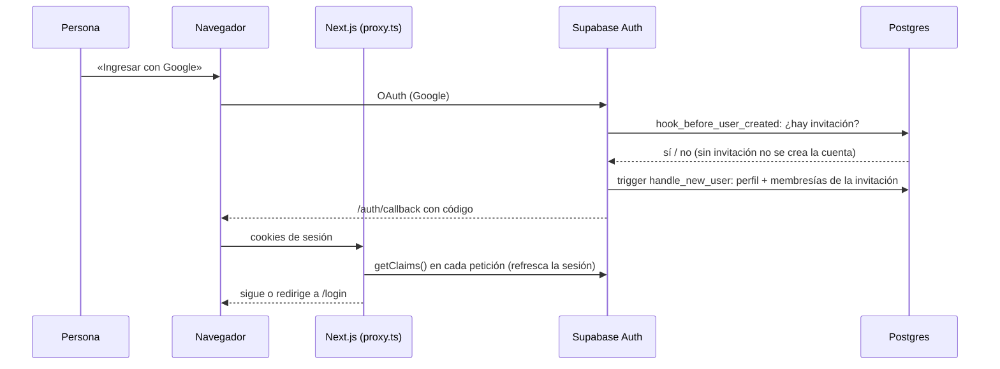
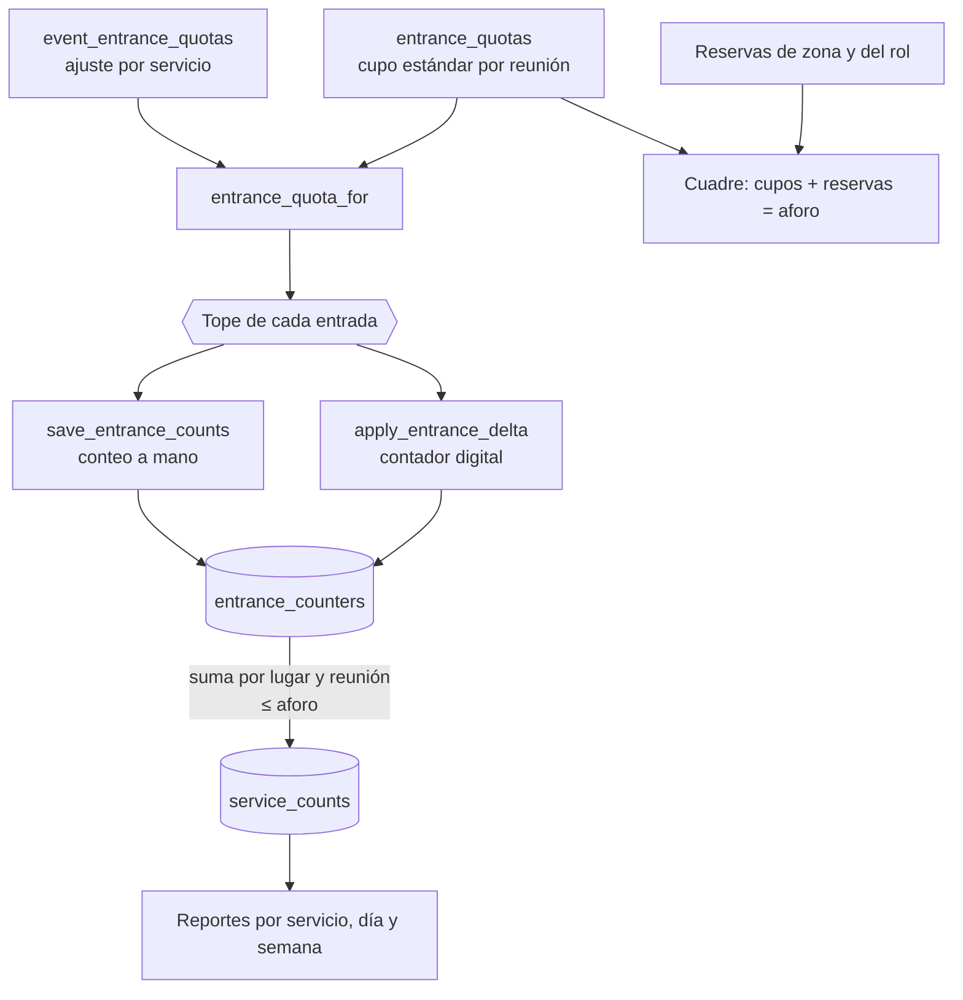
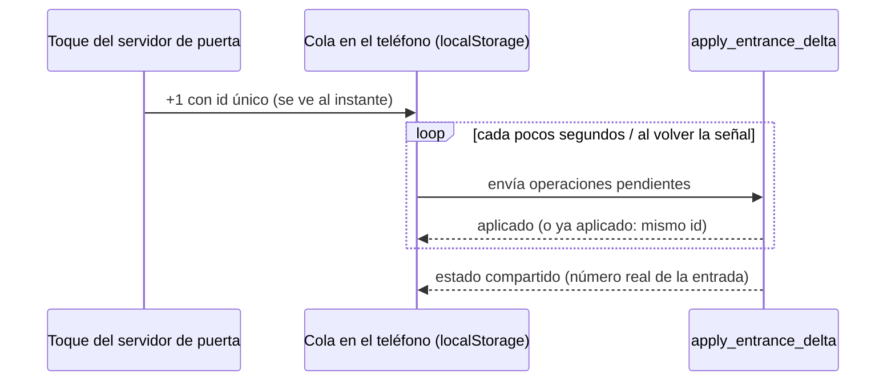
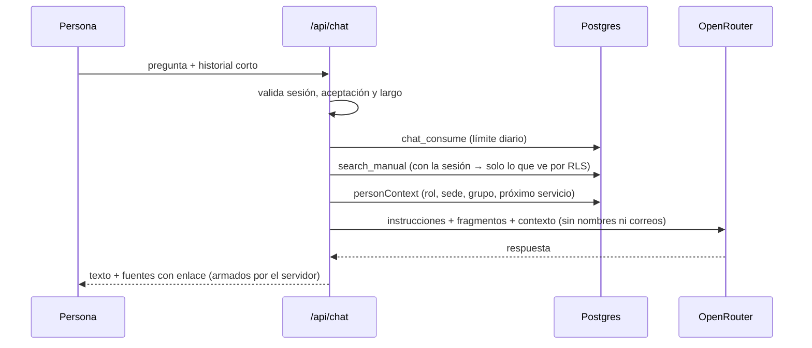

# Flujo de datos

Cómo viajan los datos por la aplicación. Referencias: [`ARQUITECTURA.md`](ARQUITECTURA.md) · [`SEGURIDAD.md`](SEGURIDAD.md).

## 1. Ingreso y sesión



- Públicas (sin sesión): `/login`, `/auth`, `/politica`, `/terminos`, `/offline`, manifiesto, iconos, `sw.js` y `/api/cron` (protegida por su propio secreto).
- Tras entrar, quien no haya aceptado la versión vigente de la política y los términos va a `/aceptar` y no ve ninguna otra pantalla ni el asistente.

## 2. Lectura de pantallas

1. Un Server Component llama a `getCurrentUser()` (rol, sedes, grupo, aceptación) y a un `load*` del tema.
2. Los `load*` consultan Supabase **con la sesión de la persona**: Postgres filtra por RLS, así que cada rol recibe solo lo suyo.
3. Las imágenes y archivos están en buckets **privados**; el servidor entrega **enlaces firmados** que vencen en 1 hora.
4. La respuesta llega al navegador como HTML/props; los componentes de cliente interactivos usan `lib/supabase/client.ts` con la misma sesión.

## 3. Escritura

```
Formulario (cliente) → lib/<tema>/mutations.ts → tabla o función SQL (con la sesión) → RLS / SECURITY DEFINER valida → fila + registro de cambios
                                                                                      └─ error → explain() → mensaje en español
```

- Escrituras simples: `insert/update/delete` sujetos a RLS (por ejemplo, el detalle de una zona: `zones.detail`, solo quien administra la sede).
- Escrituras con reglas: funciones SQL todo-o-nada (`save_counts`, `save_reservations`, `save_event_quotas`, `save_entrance_counts`, `create_support_request`, …) que validan permiso, ventana de tiempo, topes y concurrencia.
- Después de escribir, el cliente pide `router.refresh()` y la pantalla se vuelve a leer.

## 4. Conteos, cupos y aforo



- **Cupo efectivo** = ajuste del servicio si existe; si no, el estándar del horario. Una reunión heredada de una estándar usa su cupo.
- **Conteo a mano** (`save_entrance_counts`, pestaña Conteos): por entrada y reunión, tope = cupo; null borra. Todo o nada; mismo plazo que los demás conteos (`can_count_event`).
- **Contador digital** (`apply_entrance_delta`): suma/resta con idempotencia por identificador de operación, sin bajar de 0 y sin pasar del cupo ni del aforo; solo el día del servicio (`can_use_entrance_counter`).
- Ambos caminos recalculan el **total del lugar** y lo reflejan en `service_counts` (por lugar y reunión), que alimenta los reportes. El registro manual de «todo el servicio» convive.
- El **cuadre** es informativo: nunca impide guardar.
- Cada cambio de total y cada envío del contador quedan registrados (quién, cuándo, valor anterior y nuevo).

### Contador sin conexión



Lógica pura y probada en `lib/counter/queue.ts`.

## 5. Asistente (chat)



- `search_manual` busca en texto completo (español) en: posiciones, flujos, novedades vigentes, **detalle de zonas** y **entradas** (zonas que atiende y quiénes ingresan).
- El modelo solo recibe fragmentos ya filtrados por permisos; los enlaces los arma el servidor (`hrefFor`), no el modelo.
- La conversación **no se guarda**; solo el contador diario de preguntas.

## 6. Avisos al teléfono y tarea programada

- La persona activa los avisos en el navegador (`save_push_subscription`); la suscripción se guarda con sus preferencias.
- Eventos (nueva solicitud de apoyo, etc.) llaman a `lib/push/notify.ts` desde el servidor, que busca destinatarios con `service_role` **después de validar quién llama** y envía con VAPID. Se usa `after()` para no demorar la respuesta.
- `claim_notification` evita enviar dos veces el mismo aviso.
- `vercel.json` programa dos llamadas diarias a `/api/cron/pending-counts` (recordar conteos pendientes). La ruta exige `CRON_SECRET`.

## 7. Datos personales: ciclo de vida

| Etapa | Qué pasa |
|---|---|
| Alta | Solo con invitación; se guarda nombre y correo (el correo en `profile_private`); la foto de Google no se guarda |
| Uso | Datos de servicio (sede, grupo, rol, posiciones). Al modelo de IA no se envían nombres ni correos |
| Acceso | La persona descarga sus datos (JSON) desde Perfil |
| Baja | `delete_my_account`: borra perfil, correo, asignaciones, constancia e invitación; lo publicado queda sin nombre. Los totales de conteo se conservan sin nombre |
